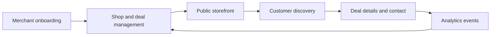
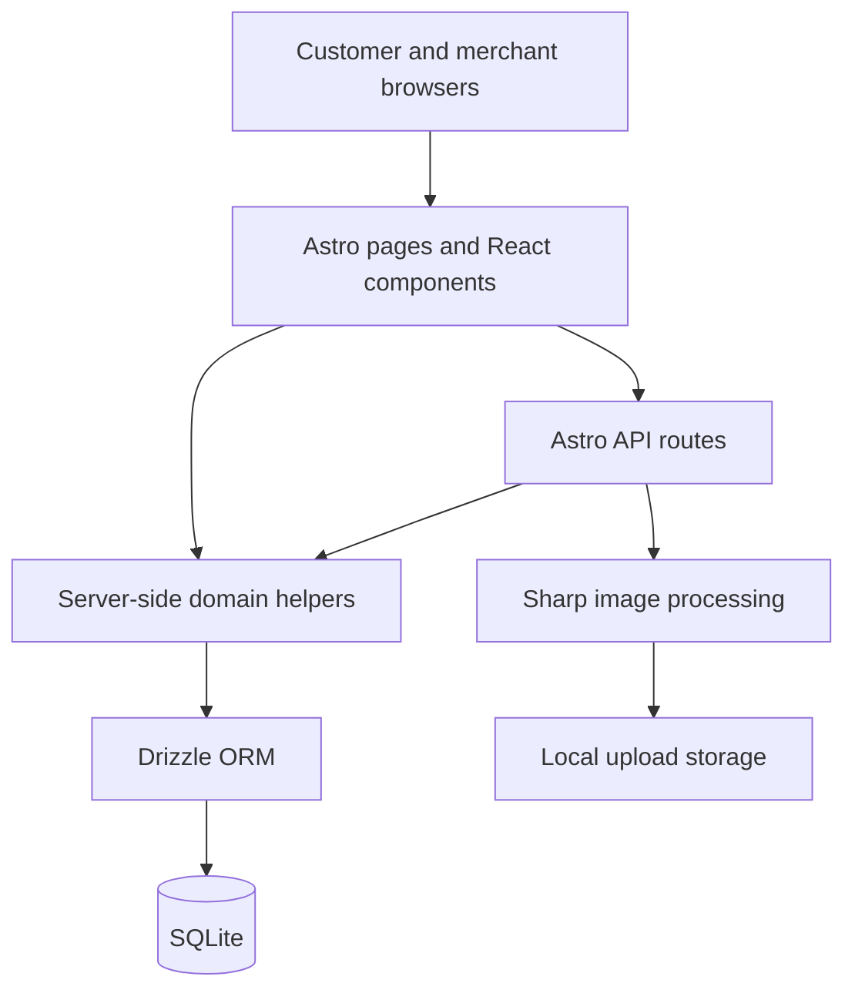

<div align="center">
  
  <h1>DealDoor</h1>
  <p><strong>A digital storefront and local deal discovery platform for small businesses.</strong></p>
  <p>One shareable shop page. Time-limited promotions. A merchant workspace behind it.</p>
  <p><a href="#product-experience">Product</a> &middot; <a href="#engineering-highlights">Engineering</a> &middot; <a href="#code-tour">Code tour</a> &middot; <a href="#run-locally">Run locally</a></p>
</div>

---

DealDoor brings shop information, promotions, contact channels, and location into one public page. Customers discover offers and find a business; merchants manage their storefront and deals from a dedicated dashboard.

Built around Thai local businesses, the project connects customer discovery, merchant operations, and platform moderation in a single full-stack application.

**Stack:** Astro · React · TypeScript · Tailwind CSS · Drizzle ORM · SQLite · Bun

## Product Experience

| Audience | Experience |
| --- | --- |
| Customers | Browse promotions, explore shops on a map, open deal details, save deals locally, and contact a shop. |
| Merchants | Register, complete onboarding, edit a storefront, manage promotions, review analytics, and share a shop link or QR code. |
| Platform operators | Review shop and deal reports through moderation tools. |



### A Storefront That Goes Beyond a Promotion Card

Each shop has a dynamic `/{slug}` page that brings its identity, offers, opening information, location, and contact links together. QR sharing connects the same storefront to offline touchpoints such as a counter or table.

The public experience includes category browsing, map exploration, individual deal pages, and browser-local saved deals. The merchant workspace handles the content that powers those pages.

## Engineering Highlights

| Area | Implementation and purpose |
| --- | --- |
| Server-rendered application | Astro server output with a standalone Node adapter; React components provide interactive forms and controls. |
| Relational data | Drizzle schema and queries model users, merchants, shops, deals, sessions, notifications, reports, and analytics. SQLite enables WAL mode and foreign-key enforcement. |
| Authentication | Argon2 password hashing, database-backed sessions, session renewal, and HTTP-only session cookies. |
| Media pipeline | Sharp validates and processes uploaded images into WebP with separate configurations for covers, logos, deals, and menu images. |
| Merchant insights | Event recording, daily aggregation functions, and top-deal queries support the analytics dashboard. |
| Discovery | Leaflet map exploration and dedicated deal/map view models keep presentation data explicit. |
| Sharing and search visibility | Server-generated QR codes, dynamic shop URLs, sitemap generation, and LocalBusiness/Offer structured-data helpers. |
| Platform foundations | In-app notification persistence, report workflows, request rate limiting, validation helpers, and security headers. |

## Architecture



The repository uses Bun for dependency management and scripts. Astro builds server output through `@astrojs/node`; the current `start` script runs that output with Bun.

## Code Tour

Start here to inspect the implementation rather than only the interface:

| Question | Entry point |
| --- | --- |
| How are business entities related? | [Database schema](db/schema.ts) |
| How do login and sessions work? | [Authentication helpers](src/lib/auth.ts) and [request middleware](src/middleware.ts) |
| How does a shop become a public page? | [Dynamic storefront](src/pages/%5Bslug%5D.astro) |
| How are merchant edits handled? | [Dashboard pages](src/pages/dashboard) and [shop API](src/pages/api/shops) |
| How does map discovery work? | [Explore page](src/pages/explore/index.astro) and [map view model](src/lib/explore/map-view-model.ts) |
| How are business metrics calculated? | [Analytics service](src/lib/analytics.ts) |
| What happens to an uploaded image? | [Upload pipeline](src/lib/upload.ts) |
| How are reports reviewed? | [Report service](src/lib/reports.ts) and [moderation page](src/pages/admin/moderation.astro) |
| What is covered by unit tests? | [Vitest test files](src/lib/__tests__) |

## Run Locally

Requires **Bun 1.3.14 or newer**, as declared in `package.json`.

```sh
git clone https://github.com/iceswift/dealdoor.git
cd dealdoor
bun install --frozen-lockfile
bun run db:push
bun run dev
```

Open [localhost:4321](http://localhost:4321). On a fresh checkout, `db:push` initializes the local schema. The current database module and Drizzle configuration use `db/dev.db`.

For optional sample storefronts, inspect and run `bun run db:seed` against a disposable local database. The seed script replaces existing sample data and includes development credentials; use it only for local evaluation.

| Command | Purpose |
| --- | --- |
| `bun run dev` | Start the development server |
| `bun run test` | Run the Vitest suite |
| `bun run build` | Build the server application |
| `bun run start` | Run the built server |
| `bun run db:studio` | Inspect local data with Drizzle Studio |

Suggested walkthrough: register a merchant account, complete onboarding, create a promotion, open its public shop page, and inspect the matching deal and map views.

## Project Status

**An evolving portfolio project with implemented frontend and backend workflows.** This overview describes the code in this repository's current default branch; it does not claim a verified live deployment, production traffic, or a completed security review.

Some modules are foundations rather than complete production integrations. For example, notification milestone handling is a placeholder, saved deals are browser-local, and admin role enforcement still needs hardening in the current middleware. A production release also needs end-to-end verification of aggregation jobs, moderation permissions, and deployment configuration.

The [design documentation](docs/README.md) records broader product and engineering plans. Treat those documents as design intent where they differ from executable code.

## Further Reading

- [Product plan](docs/01-product-plan.md)
- [Data architecture](docs/03-data-architecture.md)
- [API design](docs/07-api-design.md)
- [Testing strategy](docs/19-testing-strategy.md)
- [Deployment design](docs/20-deployment-devops.md)

Project by [iceswift](https://github.com/iceswift).
