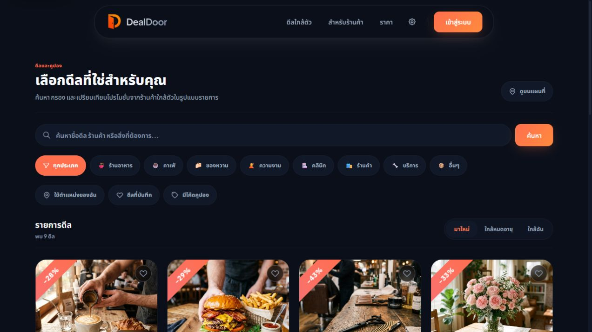
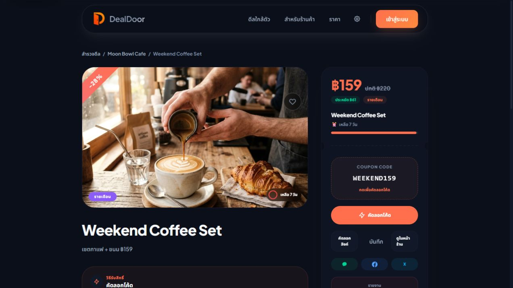
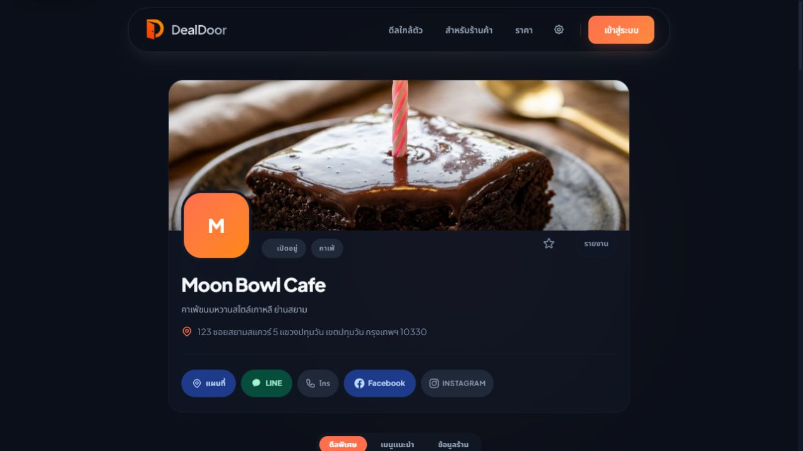
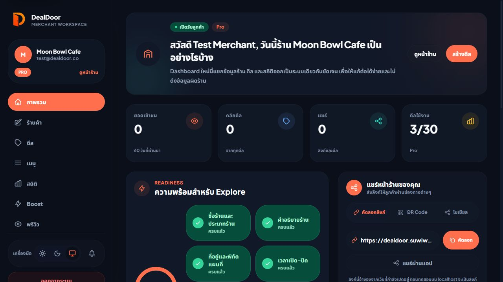
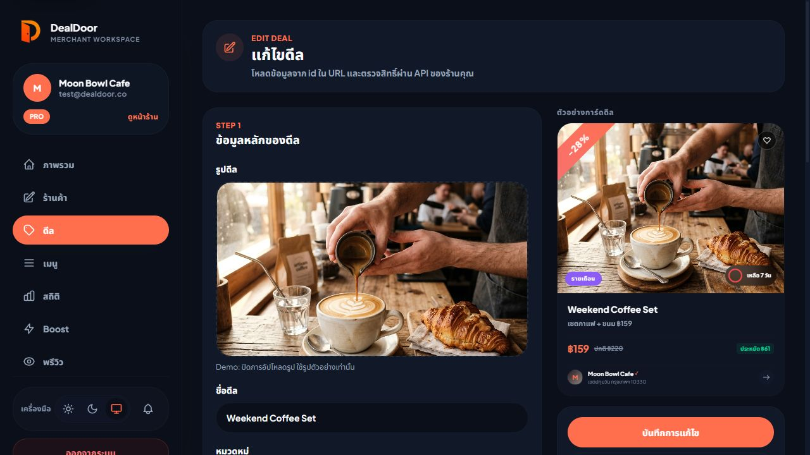
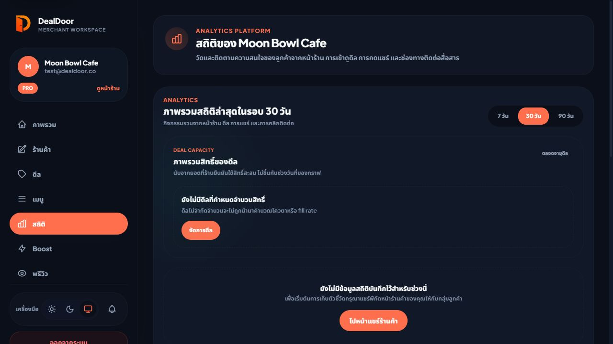
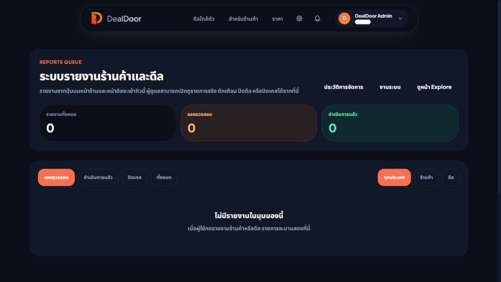

# DealDoor Showcase

[Live demo](https://dealdoor.suwiwat.com) | [Sign in and demo accounts](../../README.md#demo-accounts) | [Walkthrough video](walkthrough.mp4)

Captured from the public demo on October 23, 2026, running application commit `84c478b`. These are actual screenshots, not design mockups. No sample content was edited for the captures. Analytics and moderation empty states are shown honestly.

## Walkthrough

The 72-second silent MP4 is a screenshot-based walkthrough, not a live interaction recording. Each chapter lasts nine seconds. English captions are included in the video; the interface captures are in Thai.

| Time | Screen | What to inspect |
| --- | --- | --- |
| 00:00 | Home | Local deal discovery and search |
| 00:09 | Deals | List-first browsing and filters |
| 00:18 | Deal detail | Offer information and coupon actions |
| 00:27 | Storefront | Merchant identity, contact, and shop information |
| 00:36 | Dashboard | Merchant overview and readiness |
| 00:45 | Deal editor | Existing deal form and public preview; no changes saved |
| 00:54 | Analytics | Current sample-data empty state |
| 01:03 | Admin | Read-only demo moderation; no reports fabricated |

## Screenshots

### Home

### Deals

### Deal Detail

### Storefront

### Merchant Dashboard

### Deal Editor

### Analytics

### Admin Moderation

## Refreshing the Video

Replace screenshots with reviewed captures of the corresponding screens, then run `node scripts/create-showcase-video.mjs` from the repository root with FFmpeg installed. Set `FFMPEG_PATH` and `SHOWCASE_FONT` if needed. The script writes only temporary segment files and the showcase MP4. Review the output before publishing and update the capture date/application commit above.
